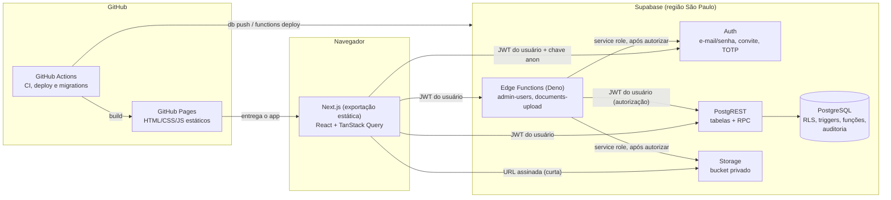
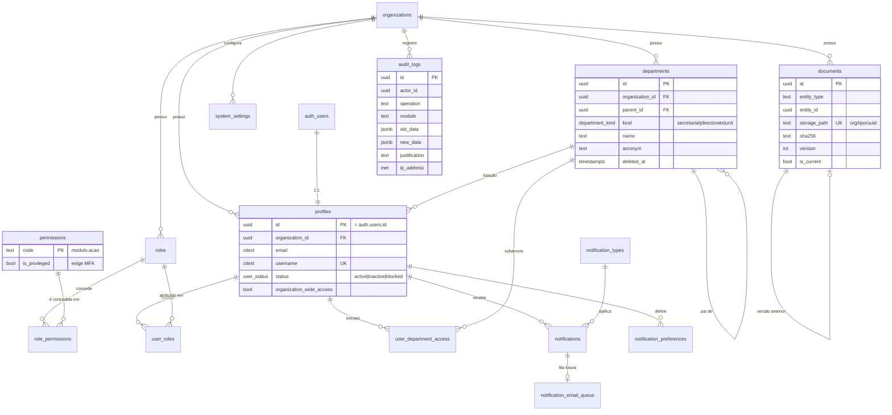

# Arquitetura — SEMFAZ Gestão

Sistema administrativo interno da Secretaria Municipal da Fazenda (SEMFAZ) da
Prefeitura Municipal de Lagarto/SE. Este documento descreve a arquitetura
técnica, a estrutura de diretórios, a modelagem inicial do banco, as
dependências e o modelo de segurança.

## 1. Visão geral



**Princípio central:** o frontend é público e estático. Toda regra de negócio,
validação definitiva e autorização fica no Supabase:

| Camada         | Responsabilidade                                                                                                                                           |
| -------------- | ---------------------------------------------------------------------------------------------------------------------------------------------------------- |
| PostgreSQL     | Constraints (CHECK, FK compostas, UNIQUE, EXCLUDE nas próximas fases), triggers de autoria e auditoria, RLS em 100% das tabelas, funções RPC transacionais |
| Edge Functions | Operações que exigem privilégio administrativo (convite e bloqueio no Auth, gravação no Storage) — sempre depois de autorizar o chamador com o próprio JWT |
| Frontend       | Experiência de uso: validação antecipada com Zod, ocultação de ações sem permissão, formatação pt-BR                                                       |

### Por que exportação estática

O GitHub Pages serve somente arquivos estáticos. O Next.js roda com
`output: "export"`: sem Server Actions, Route Handlers, middleware/proxy,
cookies de servidor ou renderização sob demanda. Consequências adotadas:

- Rotas de detalhe usam parâmetro de consulta: `/administracao/usuarios/detalhe/?id=<uuid>`.
- `basePath` configurável (`NEXT_PUBLIC_BASE_PATH`, padrão `/semfaz-gestao`) e `trailingSlash: true`.
- `404.html` gerado pelo `not-found.tsx`.
- Sessão gerenciada pelo `supabase-js` no navegador (armazenamento do próprio Supabase Auth).
- CSP aplicada por `<meta http-equiv>` (ver `docs/deployment.md`).

**Migração futura para hospedagem com servidor** (Vercel ou infraestrutura da
Prefeitura): basta remover `output: "export"` e, se desejado, mover a sessão
para cookies com `@supabase/ssr`. O backend (banco, RLS, RPC e Edge Functions)
não muda.

## 2. Estrutura de diretórios

```
.github/
  workflows/                ci.yml, deploy-pages.yml, supabase-migrations.yml
docs/                       arquitetura, banco, permissões, regras, LGPD, deploy, status, changelog
scripts/
  create-admin.mjs          criação do primeiro administrador (local, manual)
  serve-static.mjs          servidor que imita o GitHub Pages (testes)
  dev/prefetch-edge-deps.sh contorno para proxy TLS corporativo (somente dev)
src/
  app/
    (auth)/                 login, recuperar-senha, auth/confirmar, definir-senha, mfa
    (app)/                  páginas autenticadas (painel, notificações, minha conta, administração)
    layout.tsx, globals.css tokens de design, CSP e provedores
  components/
    ui/                     componentes base (padrão shadcn/ui sobre radix-ui)
    layout/                 shell, sidebar, cabeçalho, breadcrumbs, marca
    shared/                 tabela responsiva, estados, formulário, confirmação
    auth/                   guarda de rotas e de permissão (somente interface)
  modules/<módulo>/api.ts   acesso a dados por módulo (TanStack Query + supabase-js)
  providers/                sessão/acesso, React Query
  lib/                      cliente Supabase, formatação, erros, CSP, ambiente
  schemas/                  schemas exclusivos do cliente (senha, login)
  types/                    tipos gerados do banco (supabase gen types)
supabase/
  config.jsonc              configuração local (Auth, Storage, MFA, e-mails)
  migrations/               migrations versionadas (única forma de alterar o banco)
  functions/
    _shared/schemas/        schemas Zod COMPARTILHADOS com o frontend (@shared/*)
    _shared/                CORS, erros, clientes, detecção de tipo de arquivo
    admin-users/            convite, situação e reenvio de convite
    documents-upload/       envio validado de documentos
  tests/database/           testes pgTAP
  templates/                e-mails de convite e recuperação em português
  seed.sql                  seed estrutural idempotente
tests/
  unit/                     Vitest (jsdom)
  integration/              Vitest contra a API do Supabase local
  e2e/                      Playwright (desktop, tablet, celular)
```

### Módulos e menu (após a Alteração 01)

| Menu           | Rotas                                                                                                 | Módulos (`src/modules/`)                                                 |
| -------------- | ----------------------------------------------------------------------------------------------------- | ------------------------------------------------------------------------ |
| Geral          | `/`, `/notificacoes/`                                                                                 | `dashboard`, `notifications`                                             |
| Gestão         | `/cadastro-guiado/`, `/contratos/`, `/locadores/`, `/imoveis/`, `/unidades/`                          | `registration`, `contracts`, `landlords`, `properties`, `consumer-units` |
| Financeiro     | `/financeiro/faturas/`, `/financeiro/alugueis/`, `/financeiro/pagamentos/`, `/financeiro/relatorios/` | `finance` (API, gráficos, detalhamento por URL)                          |
| Acompanhamento | `/aprovacoes/` (+ Demandas, Calendário, Produtividade, Relatórios "Em breve")                         | `approvals`                                                              |
| Administração  | `/administracao/*`                                                                                    | `users`, `roles`, `departments`, `settings`                              |

O menu é declarado em `src/components/layout/navigation.ts` (rótulos de breadcrumb no mesmo arquivo).
Os detalhamentos dos relatórios usam parâmetros de URL curtos (`de`, `ate`, `imovel`, `secretaria`,
`tipo`, `situacao`, `fornecedor`, `locador`), aplicados no servidor.

Cada módulo de negócio das próximas fases segue o mesmo padrão:
migration(s) + testes pgTAP → `modules/<módulo>/api.ts` → páginas em
`app/(app)/<rota>/` → testes de integração e E2E.

## 3. Modelagem inicial do banco (Fase 1)



Detalhes de colunas, índices e constraints: `docs/database.md`.

Convenções:

- UUID como chave primária; `organization_id` em toda tabela de negócio.
- FKs compostas `(id, organization_id)` impedem vínculos entre organizações diferentes.
- `created_by/updated_by` preenchidos por trigger a partir de `auth.uid()` (nunca pelo cliente).
- Exclusão sempre lógica (`deleted_at`, `deleted_by`, `deletion_reason`); trigger bloqueia `DELETE` físico.
- Instantes em `timestamptz` (UTC); datas de calendário em `date`; dinheiro em `numeric(14,2)` (a partir da Fase 2).

## 4. Dependências

Versões fixadas no `package-lock.json` (Node.js 22).

| Pacote                                                         | Versão                        | Uso                                             |
| -------------------------------------------------------------- | ----------------------------- | ----------------------------------------------- |
| next                                                           | 16.4.6                        | App Router, exportação estática                 |
| react / react-dom                                              | 19.3.1                        | UI                                              |
| typescript                                                     | 6.0.3                         | modo estrito (+ `noUncheckedIndexedAccess`)     |
| tailwindcss                                                    | 4.3.3                         | estilos com tokens                              |
| radix-ui                                                       | 1.8.1                         | primitivos acessíveis dos componentes shadcn/ui |
| class-variance-authority, clsx, tailwind-merge, tw-animate-css | 0.7.1 / 2.1.1 / 3.7.1 / 1.4.0 | utilitários shadcn/ui                           |
| lucide-react                                                   | 1.79.0                        | ícones                                          |
| @fontsource-variable/public-sans                               | 5.3.0                         | fonte auto-hospedada (sem CDN externo)          |
| @supabase/supabase-js                                          | 2.119.2                       | Auth, PostgREST, Storage                        |
| @tanstack/react-query                                          | 5.108.4                       | cache e sincronização de dados                  |
| @tanstack/react-table                                          | 8.21.3                        | tabelas                                         |
| react-hook-form + @hookform/resolvers                          | 7.92.0 / 5.9.2                | formulários                                     |
| zod                                                            | 4.6.7                         | validação (compartilhada com as Edge Functions) |
| sonner                                                         | 2.0.8                         | mensagens de sucesso/erro                       |
| supabase (CLI)                                                 | 3.4.0                         | ambiente local, migrations, testes, tipos       |
| vitest / jsdom / Testing Library                               | 5.1.1 / 31.0.1 / 16.3.3       | testes unitários e de integração                |
| @playwright/test                                               | 1.63.0                        | E2E e responsividade                            |
| otpauth                                                        | 9.6.0                         | geração de códigos TOTP nos testes              |
| eslint / prettier                                              | 9.39.5 / 3.10.1               | qualidade de código                             |

Previstas para as próximas fases (instaladas quando usadas): Recharts
(gráficos, Fases 2–5), FullCalendar e date-fns + @date-fns/tz (Fase 4),
ExcelJS e biblioteca de PDF compatível com Deno (Fase 6).

Edge Functions (Deno 2, runtime do Supabase): `npm:@supabase/supabase-js@2.119.2`,
`npm:zod@4.6.7`, fixadas por `deno.lock`.

## 5. Segurança

### Autenticação

- Supabase Auth com e-mail e senha; **cadastro público desativado** (`enable_signup = false`).
- Novos usuários somente por **convite** (Edge Function `admin-users`, exige `users.manage`).
- Primeiro administrador: `scripts/create-admin.mjs`, executado manualmente com a service role key informada no terminal; a função `bootstrap_first_admin` só executa via `service_role` e recusa se já houver administrador ativo.
- Senha: mínimo de 10 caracteres com maiúsculas, minúsculas e números (política do Auth); troca de senha segura habilitada.
- **MFA (TOTP)**: obrigatório para Administrador; exigido de qualquer usuário que o tenha cadastrado. Permissões marcadas como `is_privileged` só valem em sessão **AAL2**.
- Usuário inativo/bloqueado: perde acesso imediatamente via RLS (`private.is_active_user()`), mesmo com JWT válido, e é banido no Auth (sem novo login nem renovação de sessão).
- Limitação de tentativas: rate limits do Supabase Auth.

### Autorização

Funções no schema `private` (não exposto pela API), todas `STABLE`,
`SECURITY DEFINER` e com `search_path` vazio:

| Função                                         | Papel                                                              |
| ---------------------------------------------- | ------------------------------------------------------------------ |
| `is_active_user()`                             | sessão com perfil ativo e não excluído                             |
| `current_org_id()`                             | organização do usuário ativo                                       |
| `has_permission(permission, department_id)`    | permissão por papel + MFA (privilegiadas) + escopo de departamento |
| `department_in_scope(department_id)`           | acesso à organização inteira ou à subárvore concedida              |
| `mfa_requirement_met()`                        | AAL2 quando exigido                                                |
| `can_access_document_entity(type, id, action)` | acesso a documentos pelo registro associado                        |
| `require_permission(...)`                      | uso nas RPCs, com erro padronizado em português                    |

- **RLS habilitada em todas as tabelas do schema public** (verificado por teste). Tabela sem política = sem acesso. O papel `anon` não tem nenhum privilégio.
- Escritas sensíveis somente por RPCs `SECURITY DEFINER` que validam permissão, escopo, organização e regras.
- Proteções em trigger (valem para qualquer caminho): ninguém altera o próprio acesso; o último administrador ativo não pode ser removido/desativado; o perfil Administrador não é editável; não é possível conceder perfil com permissões que o operador não tem (anti-escalonamento).

### Storage

- Bucket `documents` **privado**; limite de 10 MB e tipos permitidos (PDF, JPG, PNG, DOCX, XLSX).
- Envio somente pela Edge Function `documents-upload`: autoriza pelo registro associado, valida o **tipo real** por assinatura binária e a extensão, calcula **SHA-256**, grava com nome **UUID** e registra os metadados de forma transacional.
- Leitura por **URL assinada de curta duração** (padrão 60 s), liberada pela política RLS de `storage.objects` somente se o registro associado for acessível.
- Sem políticas de UPDATE/DELETE: arquivos não são apagados; substituição cria nova versão.

### Auditoria

- Trigger genérico `private.tg_audit` em todas as tabelas de negócio: usuário, operação (INSERT/UPDATE/SOFT_DELETE/...), módulo, registro, dados anteriores e posteriores, campos alterados, justificativa (`app.justification`), IP e agente do navegador.
- Login, logout e verificação de MFA auditados por trigger em `auth.sessions`.
- `audit_logs` é **somente inserção**: sem privilégios de escrita para nenhum papel e trigger que rejeita UPDATE/DELETE/TRUNCATE, inclusive para o dono da tabela.
- Consulta restrita a `audit.view` (privilegiada, exige MFA).

### Frontend

- Somente URL e chave **anon** do Supabase no build. Nenhum outro segredo.
- CSP por meta, sem scripts de terceiros, fonte auto-hospedada.
- Redirecionamento pós-login aceita apenas caminhos internos.
- Guardas de rota são **somente experiência de uso**.

### Ambientes

| Ambiente        | Backend                                    | Frontend                                |
| --------------- | ------------------------------------------ | --------------------------------------- |
| Desenvolvimento | Supabase local (Docker)                    | `next dev`                              |
| Homologação     | projeto Supabase dedicado (São Paulo)      | build com `NEXT_PUBLIC_APP_ENV=staging` |
| Produção        | projeto Supabase dedicado (Pro, São Paulo) | GitHub Pages                            |
